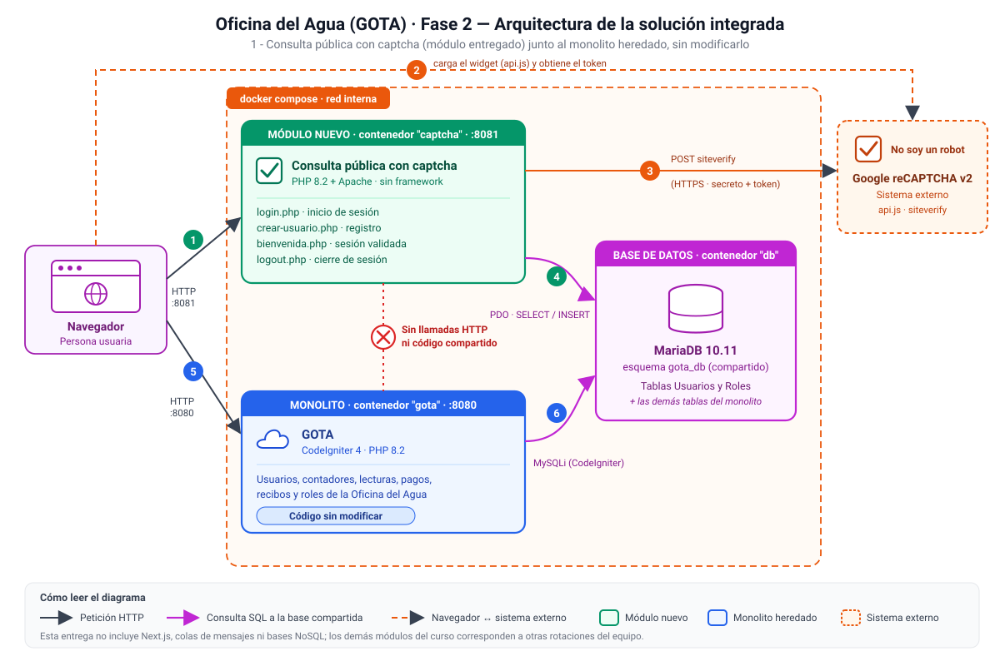

Nombre: Alan Josué Luna Cardona
Carnet: 0905-23-1346
Repositorio: (https://github.com/Alan-Josue-Luna-Cardona/GOTA-Fase-2-Captcha)
Modulo asignado: Consulta pública con captcha

# GOTA · Consulta pública con captcha

Módulo independiente de la Oficina del Agua que protege con Google reCAPTCHA v2 el inicio de sesión y la creación de usuarios. Se ejecuta junto al sistema heredado GOTA (el monolito), sin modificarlo: lo único que comparten es la base de datos.

La documentación se redactó con ayuda de Claude (Anthropic) y se verificó contra el código del repositorio y contra el flujo de pruebas descrito en la sección 4.

> **Alcance de esta entrega.** El curso define cuatro módulos (Consulta pública con captcha, Chatbot con RAG, Envío de pagos por colas y Replicación asíncrona a NoSQL), cada uno a cargo de un integrante distinto. Este repositorio contiene el monolito heredado y **únicamente** el módulo asignado a mí. Los otros tres no existen en este código, por eso no aparecen en el diagrama ni en la documentación.

## Arquitectura de la solución



El diagrama también está disponible como imagen en [`docs/architecture.png`](docs/architecture.png) (fuente editable: [`docs/architecture.svg`](docs/architecture.svg)).

### Componentes

| Componente | Función |
|---|---|
| **Consulta pública con captcha** (`consulta-publica-captcha/`, puerto 8081) | Módulo nuevo en PHP 8.2 + Apache, sin framework. Páginas `login.php`, `crear-usuario.php`, `bienvenida.php` y `logout.php`. Verifica el captcha antes de consultar o escribir en la base de datos |
| **GOTA, monolito heredado** (`GOTA-main/`, puerto 8080) | Sistema de gestión de la Oficina del Agua en CodeIgniter 4 (usuarios, contadores, lecturas, pagos, recibos, roles). Se entrega sin modificaciones |
| **MariaDB 10.11** (base `gota_db`) | Base de datos compartida. El módulo usa las tablas `Usuarios` y `Roles`; el monolito usa todas |
| **Google reCAPTCHA v2** | Sistema externo. Entrega el token al navegador y lo valida en su endpoint `siteverify` |
| **Docker Compose** (`docker-compose.yml`) | Levanta los tres servicios (`db`, `gota`, `captcha`) en una red interna con un solo comando |

### Qué representa cada conexión del diagrama

| N.º | Conexión | Qué ocurre |
|---|---|---|
| 1 | Navegador → Módulo | Peticiones HTTP al puerto 8081: formulario de inicio de sesión (`login.php`) y de registro (`crear-usuario.php`) |
| 2 | Navegador ⇢ Google | El navegador carga el widget `api.js` y la persona marca "No soy un robot"; Google entrega un token (`g-recaptcha-response`). Solo ocurre si hay llaves configuradas |
| 3 | Módulo → Google | El módulo envía por POST HTTPS a `https://www.google.com/recaptcha/api/siteverify` la llave secreta, el token y la IP. Google responde `success` verdadero o falso. Espera hasta 10 s; si no logra contactar a Google, rechaza la solicitud |
| 4 | Módulo → MariaDB | Por PDO, con consultas preparadas: `SELECT` con `JOIN` a `Roles` para validar el login, `SELECT` de roles para el desplegable, `SELECT` para detectar correos repetidos e `INSERT` del nuevo usuario |
| 5 | Navegador → GOTA | Uso normal del monolito en el puerto 8080 |
| 6 | GOTA → MariaDB | CodeIgniter accede por MySQLi a las mismas tablas |
| Línea roja punteada | Módulo ✕ Monolito | No hay llamadas HTTP ni código compartido entre los dos. El módulo no incluye, importa ni invoca ningún archivo de GOTA |

Esta entrega no incluye Next.js, colas de mensajes ni bases NoSQL, porque pertenecen a los otros módulos del curso.

## 1. Funcionalidad y objetivo

La Oficina del Agua administra cuentas con tres roles (Administrador, Secretaria y Lector). Cualquier formulario público de inicio de sesión o de registro es un blanco habitual de programas automáticos que prueban contraseñas masivamente o crean cuentas falsas. Este módulo agrega una barrera contra eso: exige resolver un captcha antes de procesar la solicitud.

El catedrático no definió qué debía consultar la "consulta pública", así que se aplicó a los dos puntos de entrada del sistema:

- **Inicio de sesión** (`/login.php`): valida el captcha, busca al usuario por correo, compara la contraseña con `password_verify()` y, si coincide, abre una sesión y redirige a `/bienvenida.php`, que muestra nombre, correo y rol.
- **Creación de usuario** (`/crear-usuario.php`): valida el captcha y los datos (nombre de al menos 3 caracteres, correo válido, contraseña de al menos 6 caracteres y rol elegido), rechaza correos ya registrados y guarda el usuario con `password_hash()`.
- **Cierre de sesión** (`/logout.php`): destruye la sesión del módulo.

Los usuarios creados desde el módulo quedan en la tabla `Usuarios` de GOTA y pueden iniciar sesión también en el monolito, porque ambos usan el mismo formato de contraseña (`PASSWORD_DEFAULT`).

## 2. Integración y responsabilidades

- **El monolito heredado se mantiene sin modificaciones.** El enunciado de la Fase 2 lo exige: ningún archivo de `GOTA-main/` fue editado (`Auth.php`, `UsuariosController.php` y las vistas son los originales). Todo el código nuevo vive en `consulta-publica-captcha/`.
- El módulo se conecta únicamente a **MariaDB** (tablas `Usuarios` y `Roles`) y a **Google reCAPTCHA**. No se comunica con el monolito.
- La sesión del módulo es independiente de la de GOTA (usa el nombre de sesión `gota_consulta_publica`): iniciar sesión en uno no inicia sesión en el otro.
- No tiene panel ni lógica de negocio propia: su responsabilidad termina en verificar el captcha y autenticar o registrar al usuario contra la base compartida.

## 3. Decisiones técnicas

**Aplicación PHP independiente y sin framework**, en lugar de agregar el captcha dentro de GOTA o crear otro proyecto CodeIgniter. Tocar el monolito estaba prohibido, y un segundo proyecto CodeIgniter habría cargado un framework completo (rutas, filtros, autoload de Composer) para cuatro páginas. El módulo no tiene dependencias externas: no ejecuta `composer install`, su imagen Docker es mínima y su código se lee completo en pocos minutos. El costo es que no hay enrutador, ORM ni protecciones automáticas de un framework (ver limitaciones).

Otras decisiones:

| Decisión | Motivo |
|---|---|
| Compartir solo la base de datos, sin API entre sistemas | Crear una API en GOTA ya sería modificarlo. Con la misma tabla y el mismo hash de contraseña, ambos sistemas comparten usuarios sin conocerse |
| `password_hash` / `password_verify` con `PASSWORD_DEFAULT` | Es el mismo algoritmo que usa `UsuariosController` de GOTA, lo que hace compatibles las cuentas entre los dos sistemas |
| PDO con consultas preparadas | Evita inyección SQL y no requiere librerías |
| reCAPTCHA v2 (casilla) y no v3 | Es visible y verificable durante una demostración en vivo; v3 trabaja en segundo plano con una puntuación |
| Rechazar si Google no responde | Con llaves configuradas, un fallo de red no deja pasar la solicitud |
| Captcha omitido si no hay llaves, con aviso en pantalla y en el log | Permite probar todo el flujo sin crear llaves antes. Con llaves, el captcha es obligatorio |
| Configuración por variables de entorno | Las llaves y credenciales no están en el código |

En el `docker-compose.yml` las variables de CodeIgniter se escriben con guion bajo (`database_default_hostname`) y no con puntos (`database.default.hostname`): los scripts de arranque de la imagen de PHP corren con `/bin/sh` (dash), que descarta las variables con puntos en el nombre. CodeIgniter acepta ambos formatos, así que el monolito se configura sin cambiar su código.

## 4. Cómo ejecutar y probar

### Requisitos previos

- Docker con Docker Compose (en Windows, Docker Desktop con WSL 2 y la virtualización activada).
- Los puertos 8080 y 8081 libres.
- Conexión a internet para descargar las imágenes y para cargar Bootstrap desde un CDN.

### Iniciar

Desde la raíz del repositorio:

```bash
docker compose up --build
```

La primera vez tarda unos minutos. El sistema está listo cuando el log de `gota` muestra `Apache/2.4... configured -- resuming normal operations`. El arranque ya aplica las migraciones del monolito y carga los tres roles (Administrador, Secretaria, Lector) si la tabla está vacía; no hay pasos manuales. Si el log muestra `Esperando a la base de datos...` una o dos veces, es normal.

Para detener: `docker compose down` (conserva los datos) o `docker compose down -v` (borra también la base de datos).

### URL

| Servicio | URL |
|---|---|
| Módulo: crear usuario | http://localhost:8081/crear-usuario.php |
| Módulo: iniciar sesión | http://localhost:8081/login.php |
| GOTA (monolito) | http://localhost:8080 |

### Variables de configuración del módulo

En Docker ya vienen definidas en `docker-compose.yml`; solo se usan en un `.env` si se ejecuta sin Docker.

| Variable | Valor en Docker | Por defecto en el código |
|---|---|---|
| `DB_HOST` | `db` | `db` |
| `DB_PORT` | `3306` | `3306` |
| `DB_NAME` | `gota_db` | `gota_db` |
| `DB_USER` | `gota_app` | `root` |
| `DB_PASSWORD` | `gota_pass_dev` (solo desarrollo local) | vacío |
| `RECAPTCHA_SITE_KEY` | vacío | vacío |
| `RECAPTCHA_SECRET_KEY` | vacío | vacío |

Mientras las dos llaves de reCAPTCHA estén vacías, el módulo muestra un aviso amarillo y no exige el captcha.

### Flujo de prueba

Datos de ejemplo: nombre `Usuario Prueba`, correo `prueba@oficina.test`, contraseña `prueba123`, rol `Lector`.

| Paso | Qué hacer | Resultado esperado |
|---|---|---|
| 1 | Abrir `/crear-usuario.php` y registrar el usuario de ejemplo | Mensaje "Usuario creado correctamente. Ya puedes iniciar sesión." El desplegable de rol muestra Administrador, Lector y Secretaria |
| 2 | Repetir el registro con el mismo correo | Error "Ya existe un usuario con ese correo." y no se crea una segunda fila |
| 3 | Registrar con contraseña de 3 caracteres | Error "La contraseña debe tener al menos 6 caracteres." |
| 4 | Abrir `/login.php` con el correo y la contraseña del paso 1 | Redirige a `/bienvenida.php` con nombre, correo y rol del usuario |
| 5 | Iniciar sesión con una contraseña incorrecta | Error "Correo o contraseña incorrectos." (el mismo mensaje exista o no el correo) |
| 6 | Abrir `/bienvenida.php` sin sesión (por ejemplo, tras `/logout.php`) | Redirige a `/login.php` |
| 7 | **Integración:** abrir `http://localhost:8080/login` e ingresar con el mismo correo y contraseña | Entra al dashboard de GOTA: el usuario creado en el módulo es válido en el monolito |
| 8 | Verificar la base de datos (comando de abajo) | La fila existe y la contraseña está guardada como hash (empieza con `$2y$`), nunca en texto plano |

```bash
docker compose exec db mariadb -ugota_app -pgota_pass_dev gota_db -e "SELECT id, nombre, email, rol_id, LEFT(password_hash, 7) AS hash FROM Usuarios;"
```

Salida esperada (el `id` puede variar):

```
+----+----------------+---------------------+--------+---------+
| id | nombre         | email               | rol_id | hash    |
+----+----------------+---------------------+--------+---------+
|  1 | Usuario Prueba | prueba@oficina.test |      3 | $2y$10$ |
+----+----------------+---------------------+--------+---------+
```

### Probar el captcha real (opcional)

1. Crear llaves reCAPTCHA **v2, casilla "No soy un robot"** en https://www.google.com/recaptcha/admin/create, con `localhost` como dominio.
2. Copiar `docker-compose.override.example.yml` como `docker-compose.override.yml` (misma carpeta) y pegar ahí las dos llaves. Ese archivo está en `.gitignore`, así que las llaves no llegan al repositorio.
3. Ejecutar de nuevo `docker compose up --build`.
4. Resultado esperado: desaparece el aviso amarillo y aparece la casilla "No soy un robot". Si se envía el formulario sin marcarla, el módulo responde "Confirma que no eres un robot." y no consulta ni escribe en la base de datos.

### Alternativa: ejecutar sin Docker (opcional)

Requiere PHP 8.2 o superior con las extensiones `intl`, `mbstring`, `mysqli` y `pdo_mysql`, Composer y un MySQL o MariaDB en el puerto 3306 (en XAMPP, usuario `root` sin contraseña).

1. Crear la base: `mysql -uroot -e "CREATE DATABASE IF NOT EXISTS gota_db CHARACTER SET utf8mb4;"`
2. Monolito (carpeta `GOTA-main`): copiar `local/gota.env.example` como `GOTA-main/.env`, luego `composer install`, `php spark migrate --all -n App -f`, `php spark db:seed RolesSeeder` (solo la primera vez) y `php spark serve --port 8080`.
3. Módulo (carpeta `consulta-publica-captcha`, otra terminal): copiar `.env.example` como `.env` y ejecutar `php -S localhost:8081 -t public`.
4. Probar con las mismas URL y el mismo flujo de arriba.

## Seguridad

- No hay contraseñas reales, llaves ni tokens en el repositorio. Los archivos `.env` y `docker-compose.override.yml` están en `.gitignore`; solo se versionan plantillas (`.env.example`, `local/gota.env.example`, `docker-compose.override.example.yml`).
- Las credenciales de `docker-compose.yml` (`rootpass_dev`, `gota_pass_dev`) son de desarrollo local, para levantar el entorno de prueba; no corresponden a ningún servicio real.
- Las contraseñas se guardan con `password_hash`; las consultas usan parámetros preparados y toda salida a HTML se escapa con `htmlspecialchars`.

## Limitaciones conocidas

- **El inicio de sesión propio de GOTA (puerto 8080) no tiene captcha.** El monolito no se modifica, así que el captcha protege los formularios del módulo, no los del monolito.
- **El registro público permite elegir cualquier rol, incluido Administrador.** El desplegable lee la tabla `Roles` completa. Es adecuado para la demostración académica, pero en producción el rol debería asignarlo un administrador.
- Los formularios no tienen token CSRF ni límite de intentos por usuario o IP; la única barrera contra automatización es el captcha.
- Con las llaves vacías el captcha se omite (comportamiento pensado para pruebas). En un despliegue real las llaves son obligatorias.
- El módulo depende del esquema actual de `Usuarios` y `Roles`: si el monolito cambia esas tablas, hay que ajustar el módulo.
- No hay pruebas automáticas: la verificación se hizo manualmente con el flujo de la sección 4.

## Estructura del repositorio

```
.
├── docker-compose.yml                  # db + gota + captcha
├── docker-compose.override.example.yml # plantilla para probar el captcha real
├── docs/
│   ├── architecture.svg                # diagrama de arquitectura (fuente)
│   └── architecture.png                # el mismo diagrama como imagen
├── local/
│   └── gota.env.example                # .env del monolito para ejecutar sin Docker
├── GOTA-main/                          # monolito heredado, sin modificaciones
└── consulta-publica-captcha/           # módulo nuevo
    ├── public/                         # login, crear-usuario, bienvenida, logout
    ├── src/                            # bootstrap, db, recaptcha, env
    ├── Dockerfile
    └── .env.example
```


